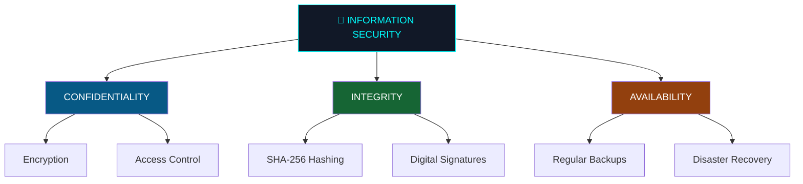
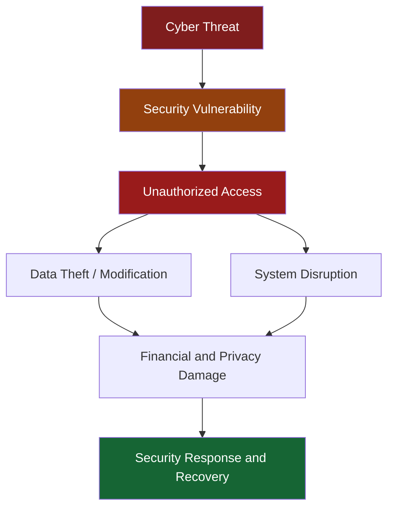
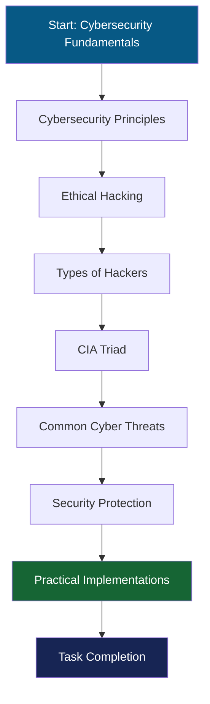

<div align="center">

# 🔐 CYBERSECURITY FUNDAMENTALS

### Securing the Digital World, One Concept at a Time.


<br>


**A cybersecurity learning project developed as part of the VirtualWork 30-Day Internship Program.**

</div>

---

## 🌐 About the Project

Cybersecurity Fundamentals is an educational project designed to explore the essential concepts of cybersecurity, ethical hacking, information security, and common cyber threats.

In today's interconnected world, protecting digital infrastructure and sensitive information is more important than ever.

This project focuses on understanding how cyberattacks work, how security professionals identify vulnerabilities, and how organizations protect their systems against digital threats.

### 🎯 Project Objectives

- Understand the fundamentals of cybersecurity.
- Explore ethical hacking and responsible security testing.
- Identify different categories of hackers.
- Understand the CIA Triad.
- Study common cyber threats and their impacts.
- Explore practical cybersecurity protection techniques.
- Develop a foundation for advanced cybersecurity learning.

---

## 📚 Learning Modules

<table>
<tr>
<td width="50%">

### 🔐 Module 01
**Cybersecurity Fundamentals**

- Cybersecurity principles
- Security objectives
- Information protection
- Digital security

</td>
<td width="50%">

### 💻 Module 02
**Ethical Hacking**

- Introduction to ethical hacking
- Authorized security testing
- Vulnerability identification
- Responsible disclosure

</td>
</tr>

<tr>
<td width="50%">

### 🕵️ Module 03
**Types of Hackers**

- White Hat Hackers
- Black Hat Hackers
- Grey Hat Hackers
- Hacker classification

</td>
<td width="50%">

### 🛡️ Module 04
**CIA Triad**

- Confidentiality
- Integrity
- Availability
- Information security model

</td>
</tr>

<tr>
<td width="50%">

### ⚠️ Module 05
**Cybersecurity Threats**

- Malware
- Phishing
- Ransomware
- Data breaches

</td>
<td width="50%">

### 🔒 Module 06
**Security Protection**

- Password security
- Encryption
- Authentication
- Data backups
- Network protection

</td>
</tr>
</table>

---

## 🛡️ The CIA Triad – Foundation of Information Security

The CIA Triad is one of the most important models in cybersecurity.

It consists of three essential security principles:



| Principle | Purpose | Example |
|---|---|---|
| Confidentiality | Prevent unauthorized information access | Encryption |
| Integrity | Protect information from unauthorized modification | SHA-256 |
| Availability | Ensure reliable access to systems | Backups |

---

## ⚔️ Types of Hackers

| Hacker Type | Description | Security Perspective |
|---|---|---|
| 🟢 White Hat | Authorized security professionals | Ethical |
| 🔴 Black Hat | Malicious attackers | Unethical |
| 🟡 Grey Hat | May investigate vulnerabilities without permission | Legally and ethically problematic |

**Remember:** Authorization is essential. Security testing must always be conducted within an approved scope.

---

## 🚨 Common Cybersecurity Threats

### 1. 🦠 Malware
Malicious software designed to damage systems, steal information, or gain unauthorized access.

Examples:
- Viruses
- Trojans
- Spyware
- Worms

### 2. 🎣 Phishing
A social engineering technique that uses deceptive communications to trick individuals into revealing sensitive information.

Examples:
- Fake banking emails
- Fraudulent login pages
- Suspicious SMS messages

### 3. 🔒 Ransomware
Malware that encrypts files or locks systems and demands payment to restore access.

Potential consequences:
- Financial losses
- Data loss
- Business disruption
- Operational downtime

---

## 🔄 How Cyberattacks Impact Systems



---

## 🔑 Cybersecurity Best Practices

| Practice | Security Benefit |
|---|---|
| Strong Passwords | Reduces account compromise risks |
| Multi-Factor Authentication | Adds authentication security |
| Encryption | Protects sensitive information |
| Regular Updates | Fixes known vulnerabilities |
| Firewalls | Controls network traffic |
| Antivirus Software | Detects malicious software |
| Regular Backups | Supports data recovery |
| Security Awareness | Reduces social engineering risks |

---

## 📂 Repository Structure

```text
Cybersecurity-Fundamentals/
│
├── README.md
│
├── Task-1-Cybersecurity-Fundamentals.md
│
├── practical-examples/
│   └── file_integrity_checker.py
│
└── assets/
    ├── cybersecurity-banner.gif
    └── cia-triad.png
```

---

## 🧪 Practical Learning

This project also aims to introduce practical cybersecurity implementations.

| Practical | Description | Technology |
|---|---|---|
| File Integrity Checker | Detect unauthorized file modifications | Python, SHA-256 |
| Password Security | Understand password strength | Python |
| Phishing Awareness | Identify suspicious messages | Security Analysis |

Practical implementations will be added as the learning activities progress.

---

## 📈 Learning Roadmap



---

## 🎓 Internship Information

<div align="center">

### VIRTUALWORK – 30 DAY INTERNSHIP


</div>

| Detail | Information |
|---|---|
| Organization | VirtualWork |
| Program | 30-Day Internship |
| Task Number | Task 01 |
| Task Name | Cybersecurity Fundamentals |
| Start | Internship commencement |
| Final Deadline | 15 December 2026 |
| Submission | GitHub Repository / Video |

**Internship Dashboard:**  
https://virtualwork.in/student/dashboard

---

## 📖 Project Documentation

Detailed documentation for Task 1:

📄 **[Read Task 1 – Cybersecurity Fundamentals](Task-1-Cybersecurity-Fundamentals.md)**

---

## 📚 Learning Resources

- [OWASP Foundation](https://owasp.org/)
- [NIST Cybersecurity](https://www.nist.gov/cybersecurity)
- [CISA Cybersecurity Resources](https://www.cisa.gov/)
- [Google Safety Center](https://safety.google/)

---

## 👨‍💻 Author

<div align="center">

### RAJ

**IT Student | Aspiring Cybersecurity Engineer | Technology Enthusiast**

Interested in:

`Cybersecurity` `Ethical Hacking` `AI` `Software Development` `Cloud Security`

---

### 🔐 LEARN • ANALYZE • SECURE • PROTECT

*Building knowledge. Developing skills. Creating a safer digital future.*

**VirtualWork Internship – Task 01**

</div>
