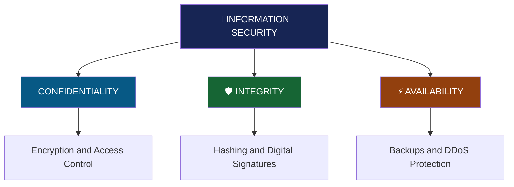
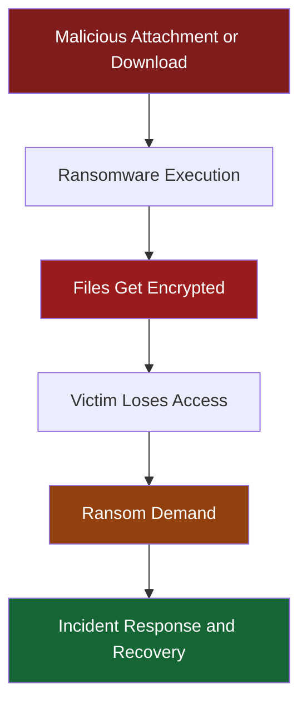

# 🔐 CYBERSECURITY FUNDAMENTALS

### Understanding Cybersecurity | Ethical Hacking | Digital Protection

**VirtualWork – 30-Day Internship Program**

**Task 01 | Cybersecurity Fundamentals**

---

**Prepared by: Raj**

**Submission Deadline: 15 December 2026**

**Submitted on:  15 November 2026** 

---

## 📌 Table of Contents

1. [Introduction](#-1-introduction)
2. [Cybersecurity vs Ethical Hacking](#-2-cybersecurity-vs-ethical-hacking)
3. [Types of Hackers](#-3-types-of-hackers)
4. [CIA Triad](#-4-cia-triad)
5. [Common Cybersecurity Threats](#-5-common-cybersecurity-threats)
6. [Prevention and Protection](#-6-prevention-and-protection)
7. [Real-World Examples](#-7-real-world-examples)
8. [Conclusion](#-8-conclusion)
9. [References](#-9-references)

---

# 🔹 1. Introduction

Cybersecurity is one of the most important areas of modern technology. As businesses, governments, and individuals increasingly depend on digital systems, protecting sensitive information and computer networks has become essential.

Cybersecurity involves protecting computers, servers, networks, applications, and digital information against unauthorized access, cyberattacks, data theft, and damage.

### 🎯 Objectives

- Understand fundamental cybersecurity principles.
- Learn the basics of ethical hacking.
- Identify different types of hackers.
- Understand the CIA Triad.
- Explore common cyber threats.
- Learn essential cybersecurity protection methods.

---

# 🔹 2. Cybersecurity vs Ethical Hacking

## 🛡️ What is Cybersecurity?

Cybersecurity is the practice of protecting digital systems, networks, applications, and sensitive information from cyber threats.

**Key activities:**

- Network security
- Application security
- Data protection
- Identity and access management
- Security monitoring
- Incident response

## 💻 What is Ethical Hacking?

Ethical hacking is the authorized process of testing computer systems, applications, and networks to discover security vulnerabilities before malicious attackers exploit them.

Ethical hackers work within an approved scope and follow responsible disclosure practices.

**Key activities:**

- Vulnerability assessment
- Penetration testing
- Security auditing
- Authentication testing
- Security reporting

### ⚖️ Key Differences

| Cybersecurity | Ethical Hacking |
|---|---|
| Broad security discipline | Specialized security activity |
| Protects digital infrastructure | Tests security weaknesses |
| Focuses on prevention and defense | Focuses on identifying vulnerabilities |
| Includes monitoring and incident response | Includes authorized attack simulations |

---

# 🔹 3. Types of Hackers

Hackers are commonly classified into three categories based on their intentions and authorization.

## 🟢 3.1 White Hat Hackers

White Hat hackers are authorized security professionals who identify vulnerabilities and help organizations strengthen their security.

**Examples:**
- Penetration testers
- Security researchers
- Bug bounty hunters

**Objective:** Improve cybersecurity.

## 🔴 3.2 Black Hat Hackers

Black Hat hackers are malicious individuals who exploit security vulnerabilities for personal, financial, or other harmful purposes.

**Examples:**
- Stealing passwords
- Deploying ransomware
- Unauthorized data theft

**Objective:** Exploit systems for malicious purposes.

## 🟡 3.3 Grey Hat Hackers

Grey Hat hackers may discover and investigate vulnerabilities without obtaining prior authorization. They might report the issues without malicious intentions, but unauthorized access can still violate laws and policies.

**Objective:** Discover security weaknesses, sometimes without permission.

### Hacker Classification

| Type | Authorization | Intention |
|---|---|---|
| White Hat | Authorized | Improve security |
| Black Hat | Unauthorized | Malicious |
| Grey Hat | Often unauthorized | Not necessarily malicious |

---

# 🔹 4. CIA Triad

The CIA Triad is a fundamental information security model consisting of three principles:

1. Confidentiality
2. Integrity
3. Availability

It provides a foundation for designing secure information systems.

## 🔐 4.1 Confidentiality

Confidentiality ensures that sensitive information is accessible only to authorized individuals.

**Security techniques:**
- Encryption
- Password protection
- Multi-Factor Authentication
- Role-Based Access Control

**Example:** Encrypting banking information so unauthorized individuals cannot read it.

## 🛡️ 4.2 Integrity

Integrity ensures that information remains accurate, consistent, and protected against unauthorized modification.

**Security techniques:**
- SHA-256 hashing
- Digital signatures
- File integrity monitoring
- Access permissions

**Example:** Using SHA-256 hashes to detect whether a downloaded file has been modified.

## ⚡ 4.3 Availability

Availability ensures that systems, applications, and information remain accessible to authorized users whenever required.

**Security techniques:**
- Regular backups
- Disaster recovery
- Redundant infrastructure
- DDoS protection

**Example:** Maintaining backup servers so a website can continue operating if its primary server fails.

## CIA Triad Diagram

### CIA Triad Summary

| Principle | Main Purpose | Example |
|---|---|---|
| Confidentiality | Protect information from unauthorized access | Encryption |
| Integrity | Prevent unauthorized data modification | SHA-256 |
| Availability | Ensure reliable access to systems | Backups |

---

# 🔹 5. Common Cybersecurity Threats

Cyber threats are malicious activities that target computers, networks, applications, and sensitive information.

## 🦠 5.1 Malware

Malware stands for malicious software. It is designed to damage systems, steal information, disrupt operations, or gain unauthorized access.

**Types of Malware:**

| Type | Description |
|---|---|
| Virus | Attaches itself to files and spreads when executed |
| Trojan | Disguises itself as legitimate software |
| Spyware | Secretly monitors user activities |
| Worm | Self-replicates and spreads across systems |

**Impact:**
- Data theft
- System damage
- Unauthorized access
- Performance degradation

## 🎣 5.2 Phishing

Phishing is a social engineering attack in which attackers use deceptive emails, messages, or websites to trick users into revealing sensitive information.

**Common examples:**

- Fake banking emails
- Fraudulent login pages
- Suspicious SMS messages
- Fake account verification requests

**Impact:**
- Password theft
- Financial fraud
- Identity theft
- Unauthorized account access

## 🔒 5.3 Ransomware

Ransomware is a type of malware that encrypts files or locks computer systems and demands payment to restore access.

**How it works:**

**Impact:**
- File encryption
- Business disruption
- Financial losses
- Data loss
- Operational downtime

---

# 🔹 6. Prevention and Protection

Cybersecurity requires preventive measures to reduce the possibility of successful attacks.

| Security Practice | Purpose |
|---|---|
| Strong Passwords | Prevent unauthorized account access |
| Multi-Factor Authentication | Add another authentication layer |
| Antivirus Software | Detect and remove malicious software |
| Regular Updates | Fix known security vulnerabilities |
| Data Backups | Recover important information |
| Firewalls | Control incoming and outgoing network traffic |
| Security Awareness | Reduce phishing and social engineering risks |

### Essential Security Recommendations

1. Never share passwords or OTPs.
2. Avoid clicking suspicious links.
3. Download applications only from trusted sources.
4. Enable Multi-Factor Authentication.
5. Regularly update operating systems and applications.
6. Maintain secure backups.
7. Monitor unusual account and network activity.

---

# 🔹 7. Real-World Examples

| Threat | Real-World Scenario | Potential Impact |
|---|---|---|
| Malware | Infected software download | System compromise |
| Phishing | Fake bank login website | Credential theft |
| Ransomware | Organization's files encrypted | Operational disruption |
| Data Breach | Unauthorized database access | Sensitive information exposure |
| DDoS | Excessive malicious network traffic | Service unavailability |

These examples demonstrate why organizations need strong cybersecurity policies and technical defenses.

---

# 🔹 8. Conclusion

Cybersecurity is essential for protecting digital information, computer systems, and network infrastructure.

Through this task, I explored the fundamentals of cybersecurity, the difference between cybersecurity and ethical hacking, different types of hackers, the CIA Triad, and common cyber threats such as malware, phishing, and ransomware.

Understanding these concepts provides a strong foundation for further learning in ethical hacking, penetration testing, network security, and security engineering.

**Learning cybersecurity is not just about understanding attacks; it is about building safer digital systems.**

---

# 🔹 9. References

1. [OWASP Foundation](https://owasp.org/)
2. [National Institute of Standards and Technology (NIST)](https://www.nist.gov/cybersecurity)
3. [CISA – Cybersecurity Resources](https://www.cisa.gov/)
4. [Google Safety Center](https://safety.google/)
5. [VirtualWork Internship Dashboard](https://virtualwork.in/student/dashboard)

---

## 🎓 INTERNSHIP SUBMISSION

**Organization:** VirtualWork

**Program:** 30-Day Internship

**Task:** Task 1 – Cybersecurity Fundamentals

**Submitted by:** Raj

**Submitted on:** 15-11-2026

**Deadline:** 15 December 2026

---

### 🔐 LEARN • SECURE • PROTECT

*Building a safer digital world through cybersecurity knowledge.*

