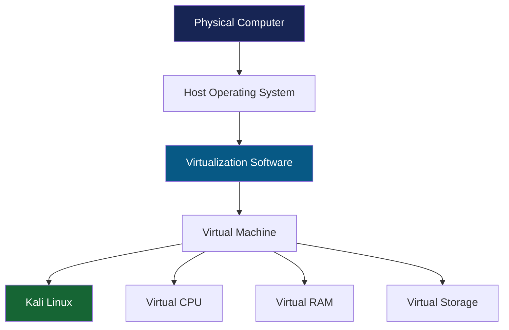
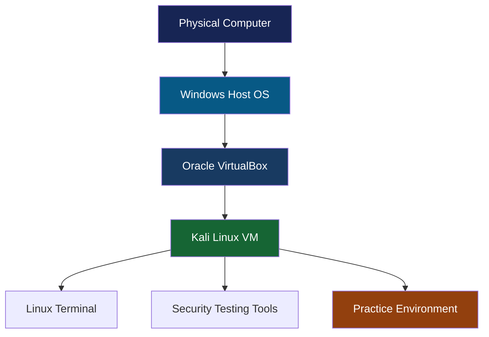

<div align="center">

# 🖥️ TASK 02 – VIRTUAL LAB SETUP

### Building a Safe Environment for Cybersecurity Practice


**VirtualWork – 30-Day Internship Program**

**Prepared by: Raj**

**Deadline: 15 December 2026**

</div>

---

# 📌 Table of Contents

1. [Introduction](#-1-introduction)
2. [Objectives](#-2-objectives)
3. [What is Virtualization?](#-3-what-is-virtualization)
4. [Host OS vs Guest OS](#-4-host-os-vs-guest-os)
5. [Tools and Technologies](#-5-tools-and-technologies)
6. [Kali Linux Overview](#-6-kali-linux-overview)
7. [Virtual Lab Architecture](#-7-virtual-lab-architecture)
8. [Installation Procedure](#-8-installation-procedure)
9. [Virtual Machine Configuration](#-9-virtual-machine-configuration)
10. [Network Configuration and Isolation](#-10-network-configuration-and-isolation)
11. [Importance of Controlled Environments](#-11-importance-of-controlled-environments)
12. [Security Best Practices](#-12-security-best-practices)
13. [Testing and Verification](#-13-testing-and-verification)
14. [Screenshots](#-14-screenshots)
15. [Conclusion](#-15-conclusion)
16. [References](#-16-references)

---

# 🔹 1. Introduction

A virtual lab is an isolated computing environment used to practice cybersecurity concepts, perform security experiments, and understand operating system behavior without directly affecting the primary computer.

In ethical hacking, a controlled environment is essential because security testing may involve potentially harmful activities.

This task focuses on setting up Kali Linux using virtualization software and understanding how virtual machines provide a safe environment for cybersecurity learning.

---

# 🎯 2. Objectives

The main objectives of this task are:

- Understand virtualization technology.
- Learn the difference between host and guest operating systems.
- Install and configure Oracle VirtualBox.
- Set up Kali Linux as a virtual machine.
- Understand virtual machine networking.
- Learn the importance of isolated testing environments.
- Practice basic Linux operations.

---

# 🖥️ 3. What is Virtualization?

Virtualization is a technology that allows multiple virtual computers to operate on a single physical computer.

A virtual machine behaves like an independent computer with its own operating system, memory allocation, storage, and virtual hardware.

### Benefits of Virtualization

| Benefit | Description |
|---|---|
| Isolation | Separates virtual environments from the host |
| Flexibility | Allows multiple operating systems |
| Cost Efficiency | Reduces the need for additional hardware |
| Snapshots | Allows restoration to an earlier VM state |
| Testing | Provides an environment for controlled experiments |

### Virtualization Architecture



---

# 🔹 4. Host OS vs Guest OS

A host operating system runs directly on the physical computer, while a guest operating system runs inside a virtual machine.

| Host OS | Guest OS |
|---|---|
| Installed on physical hardware | Installed inside a virtual machine |
| Manages physical resources | Uses allocated virtual resources |
| Example: Windows 11 | Example: Kali Linux |
| Primary operating system | Virtual operating system |

**Example:**

My Windows computer acts as the host operating system, while Kali Linux runs as a guest operating system through VirtualBox.

---

# 🔹 5. Tools and Technologies

The following tools are used to create the virtual cybersecurity lab.

### 1. Oracle VirtualBox

VirtualBox is an open-source virtualization platform that allows users to create and manage virtual machines.

**Purpose:**
- Create virtual machines.
- Allocate CPU and RAM.
- Configure virtual networks.
- Manage virtual storage.
- Create snapshots.

Official Website: https://www.virtualbox.org/

### 2. Kali Linux

Kali Linux is a Debian-based Linux distribution designed for penetration testing, security auditing, digital forensics, and cybersecurity research.

**Features:**
- Security testing tools.
- Network analysis utilities.
- Vulnerability assessment tools.
- Digital forensics utilities.
- Linux command-line environment.

Official Website: https://www.kali.org/

### 3. 7-Zip

7-Zip is a file compression and extraction utility.

**Purpose:** Extract downloaded virtual machine archives when required.

Official Website: https://www.7-zip.org/

---

# 🔹 6. Kali Linux Overview

Kali Linux is widely used by cybersecurity professionals, penetration testers, and security researchers.

It provides a collection of tools for authorized security testing.

### Common Kali Linux Tools

| Tool | Purpose |
|---|---|
| Nmap | Network discovery and security auditing |
| Wireshark | Network packet analysis |
| Burp Suite | Web application security testing |
| Metasploit Framework | Security testing and exploit validation |
| John the Ripper | Password security auditing |

**Important:** These tools must only be used on systems you own or have explicit authorization to test.

---

# 🔹 7. Virtual Lab Architecture

The proposed cybersecurity lab uses Windows as the host operating system and Kali Linux as the guest operating system.



### Lab Components

- Host Machine: Windows computer.
- Virtualization Platform: Oracle VirtualBox.
- Guest Operating System: Kali Linux.
- Virtual Storage: Virtual hard disk.
- Network Mode: NAT initially, or an isolated host-only network for controlled local testing.

---

# 🔹 8. Installation Procedure

## Step 1: Download VirtualBox

1. Visit the official VirtualBox website.
2. Select the Windows host installer.
3. Download the installation package.
4. Install VirtualBox.

## Step 2: Download Kali Linux

1. Visit the official Kali Linux website.
2. Navigate to Virtual Machines.
3. Select the VirtualBox image.
4. Download the appropriate 64-bit image.

## Step 3: Extract the Downloaded File

Use an archive utility such as 7-Zip if the downloaded file is compressed.

## Step 4: Import Kali Linux into VirtualBox

1. Open VirtualBox.
2. Select the Import option if using an appliance file.
3. Alternatively, open the downloaded VM configuration file.
4. Review the virtual machine settings.
5. Start the virtual machine.

## Step 5: Complete Initial Setup

1. Start Kali Linux.
2. Log in using the credentials provided by the official download documentation.
3. Explore the desktop environment.
4. Open the terminal.
5. Verify the operating system.

---

# 🔹 9. Virtual Machine Configuration

The following are suggested starting configurations for a Kali Linux learning environment.

| Component | Recommended Configuration |
|---|---|
| Operating System | Kali Linux 64-bit |
| RAM | 4 GB |
| CPU | 2 cores |
| Virtual Disk | 40–60 GB |
| Virtualization | Intel VT-x / AMD-V |
| Network | NAT initially |

Actual settings should be adjusted based on the host computer's available resources.

### Why Snapshots Matter

A virtual machine snapshot captures its state at a particular point in time.

Snapshots help restore the virtual machine after unsuccessful experiments or configuration changes.

**Example:**

Create a snapshot named:

`Kali-Linux-Clean-Installation`

---

# 🔹 10. Network Configuration and Isolation

Network isolation is an important part of cybersecurity lab management.

VirtualBox provides different networking modes.

| Network Mode | Description |
|---|---|
| NAT | Allows outbound connectivity through the host |
| Bridged Adapter | Connects the VM to the physical network |
| Host-Only | Allows communication between host and VM |
| Internal Network | Allows communication between selected VMs |

### Recommended Learning Configuration

Start with NAT for basic updates and downloads.

For controlled local security experiments, use an isolated host-only or internal network.

Avoid bridged networking for security experiments unless you understand and specifically require its network exposure.

---

# 🔹 11. Importance of Controlled Environments

A controlled environment helps cybersecurity learners perform experiments without unnecessarily exposing external systems.

### Key Advantages

**1. Safety**

Reduces the risk of affecting the primary operating system.

**2. Isolation**

Provides separation between the host computer and virtual lab.

**3. Experimentation**

Allows learners to test configurations and security concepts.

**4. Recovery**

Snapshots make it easier to restore previous virtual machine states.

**5. Legal and Ethical Testing**

Provides a dedicated environment for authorized security exercises.

---

# 🔹 12. Security Best Practices

- Use virtual machines for cybersecurity experiments.
- Keep virtualization software updated.
- Use snapshots before major experiments.
- Avoid testing unauthorized systems.
- Do not use personal credentials inside experimental environments.
- Keep suspicious files isolated.
- Disable unnecessary shared folders and clipboard integration.
- Use isolated virtual networks for security exercises.
- Maintain backups of important virtual machine files.

---

# 🔹 13. Testing and Verification

After installation, perform basic verification.

### Check Operating System

Open the Kali Linux terminal:

```bash
cat /etc/os-release
```

### Check Kernel Information

```bash
uname -a
```

### Check IP Configuration

```bash
ip addr
```

### Check Available Storage

```bash
df -h
```

### Expected Outcome

The commands should display:

- Kali Linux operating system information.
- Linux kernel details.
- Available network interfaces.
- Filesystem storage information.

These checks help confirm that the virtual machine is operating correctly.

---

# 🔹 14. Screenshots

Add genuine screenshots from your completed installation.

Create a folder named `screenshots/` and include:

| Screenshot | Description |
|---|---|
| virtualbox-installed.png | VirtualBox installation |
| kali-vm-configuration.png | Kali virtual machine settings |
| kali-desktop.png | Kali Linux desktop |
| terminal-verification.png | Terminal verification commands |
| network-configuration.png | Virtual machine network settings |

Example Markdown:

```markdown


```

*Screenshots should be captured from your actual environment after completing the setup.*

---

# 🔹 15. Conclusion

Through this task, I explored virtualization technology and its importance in cybersecurity education.

I learned how virtual machines provide isolated environments for security experiments and how Kali Linux can be used as a platform for authorized security testing.

I also studied host and guest operating systems, virtual machine configurations, network modes, snapshots, and basic Linux verification commands.

A properly configured virtual lab provides a safer foundation for learning ethical hacking and advanced cybersecurity concepts.

---

# 🔹 16. References

1. [Kali Linux Official Website](https://www.kali.org/)
2. [Kali Linux Virtual Machines Documentation](https://www.kali.org/docs/virtualization/)
3. [Oracle VirtualBox Official Website](https://www.virtualbox.org/)
4. [VirtualBox User Manual](https://www.virtualbox.org/manual/)
5. [NIST Cybersecurity Resources](https://www.nist.gov/cybersecurity)

---

<div align="center">

## 🎓 VIRTUALWORK INTERNSHIP SUBMISSION

**Organization:** VirtualWork

**Program:** 30-Day Internship

**Task:** Task 02 – Virtual Lab Setup

**Prepared by:** Raj

**Deadline:** 15 December 2026

---

### 🖥️ LEARN • EXPERIMENT • SECURE

*Building a safe foundation for ethical hacking and cybersecurity research.*

</div>
